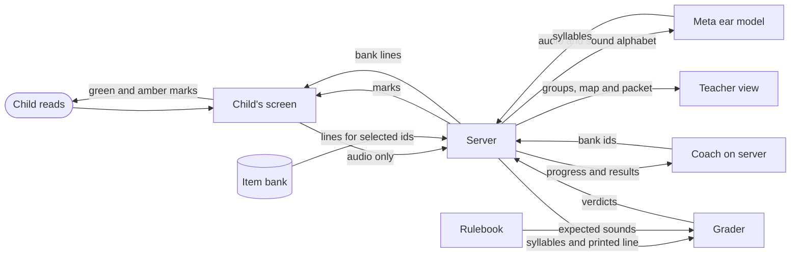

# Kriah Listener

A child reads one line of Hebrew aloud and sees, letter by letter, what they read right. The teacher gets practice groups, a letter and vowel map, and a printable packet without listening to a recording.

<p>
  
  
</p>


## Why kriah

Kriah is learning to decode Hebrew with its vowel marks, called nekudos. It is taught in the first years of Jewish day school. One teacher cannot listen to every child read every day. The mistakes that matter are small: a missed dagesh, a sheva read wrong, a kamatz katan. Children read aloud in three pronunciation traditions: Sephardi, Ashkenazi and Chassidish. A generic speech tool can mark a correct reading wrong when it expects another tradition.

## How it works



1. **Ear.** A child taps an animal and reads a line. The model gets audio and a sound alphabet. It never sees the printed line, so the line cannot steer its answer. If the child says `sha-vos`, the ear writes `sha-vos`. It can still mishear. Prose, including short refusals, counts as a failed call; syllables outside the sound alphabet become `?`.
2. **Rulebook and grader.** Plain code defines expected sounds in all three traditions. The grader compares `sha-vos` with what שַׁבָּת should sound like in the child's tradition. In Ashkenazi pronunciation the bet should be b, so the amber mark lands under the bet. The previous line shows green and amber marks while the child reads the next line. Flagged cases accept alternative readings.
3. **Coach.** The server runs the coach at each checkpoint to pick the next bank ids. Code checks the ids and allowed levels, then resolves them to bank lines. A rule selects lines when the model is unavailable or its answer fails validation.

## Meta models, and what we learned

The [ear test notes](docs/ear-test.md) record the synthetic trials. The [live run](docs/live-run.md) records a full turn through the server.

| Job | Meta model | What happened |
| --- | --- | --- |
| Ear | Muse Spark 1.3 | Corrected readings toward real words. Mostly returned `?` in the later synthetic trials. |
| Ear | Muse Spark 1.2 | Answered in prose on about a third of the clips. Those answers count as failed calls. |
| Ear | Muse Wonder 1.0 (`muse-wonder-1.0`), Meta Model API | Chosen fallback. Reported 5 of 7 planted mistakes in each of two runs, with no prose. Minimal reasoning took about 2 seconds a line instead of 15. Used as the ear in the full server run. |
| Ear | Muse Voice Transcribe 1.0, Meta transcription API | Tried and rejected. Fast, but writes words, corrects toward real ones and drops nikud. |
| Ear | Muse Spark Open (`meta-models/muse-spark-open-1026`), Baseten | Wired as the primary ear, not yet run. |
| Coach | Muse Spark 1.3 (`muse-spark-1.3`), Meta Model API | First failed live by spending its whole 2,000 token limit on reasoning. With 16,000 tokens and minimal reasoning, answered 7 of 7 checkpoints in the live run. All picks passed validation. |

Meta may train on content sent in contributor mode, so only standard tier is used. No model id ending in `-contributor` is used: the ear refuses those ids, and the coach uses a fixed standard id.

## What the tests show so far

### Status as of 2026-10-26

- **Rulebook.** AI reviewers checked every distinct siddur word in all three traditions. A second AI review confirmed each finding. Fixes have regression tests and a before and after comparison of every word. No human kriah teacher has reviewed it yet. [Review](docs/check/rulebook-review.md) and [Shema page for the hand check](docs/check/shema.md).
- **Synthetic ear test.** The script defines 13 clips: 7 planted mistakes and 6 clean controls. Wonder reported 5 of the 7 plants in each of two recorded runs. The saved notes do not support a complete grader accuracy rate. [Results and limits](docs/ear-test.md).
- **Live server run.** Synthetic speech completed 25 of 25 lines. The coach answered 7 of 7 checkpoints with valid picks. This checks the full path through the server, not accuracy on real voices. [Run record](docs/live-run.md).
- **Offline tests.** 510 root tests and 79 station tests pass. They cover sheva na and nach, kamatz katan, dagesh, silent letters, the divine names, restarts and rereads in the alignment, and all three traditions. They also check server retries, saved progress, packet selection and station screens. Synthetic inputs and model substitutes do not establish accuracy on real voices.
- **Real voices.** Neither the adult nor child round has run. The real-voice test is still the go or no-go.

### Before the child round

- Obtain written parent consent.
- Turn Meta Model API free credits off and a paid plan on. Meta's free-credit terms allow content to be used for product improvement.
- Pass the adult round first.

## Data and privacy

The ear never sees the text it grades. No model writes Hebrew a child reads. There is no chat or free-text AI feedback in child, teacher or parent screens. Messages use templates. Model reasons appear only in the PIN-protected developer trace when enabled. Keys stay on the server.

The station and server grade audio in memory and drop it. They never write audio to disk or a log. `data/store.json` holds first names, avatars, pronunciation presets, progress profiles, per-letter and vowel read history, stars and turn summaries with coded decisions and template logs. It holds no audio, transcripts or coach reasons. The store keeps the last 60 turns per child; the detail screen shows the last 20. The server computes earned stars from its own grades and caps the browser's requested award. Teachers must enter first names only; the server enforces a single word, not whether it is a first name.

The separate [local clip recorder](tools/clip-recorder/README.md) saves test WAVs in gitignored `recordings/private/`. Child recording requires written parent consent. Its child test runner deletes each clip after printing the result, including failures, unless `--keep` is set. Adult clips remain until manually removed. Closing the recorder does not delete saved clips.

## Run it

Use Node 22.12 or newer. Dependencies are in `station/`.

For a keyless preview, run from the repo root:

```bash
npm --prefix station ci
npm run demo
```

Open http://localhost:5173/?mock. The gray Demo pill labels mock mode. It shows invented children, fixed simulated grades and teacher screens without a microphone, API keys or a backend. About a third of lines have one or two amber marks. Any PIN of 4 to 12 digits opens the mock teacher view. See the [station README](station/README.md) for screen routes.

For the real station, use a fresh terminal at the repo root:

```bash
cp .env.example .env
npm run build
```

`npm run build` installs the station's dependencies and builds it.

Set the API key and `TEACHER_PIN` in `.env`, then run:

```bash
npm start
```

`npm start` runs `node server/index.js`. Open http://127.0.0.1:8787. The server binds to `127.0.0.1` unless `HOST` is set. For a classroom tablet on the same network, set `HOST=0.0.0.0` and open the server computer's address on that tablet.

The first screen is empty until a teacher adds children: tap Teacher, enter the PIN, open Roster, and add a child. `TEACHER_PIN` must contain 4 to 12 digits. Missing or invalid values stop startup before the server listens. The PIN pad accepts digits and caps input at 12. Startup reports a missing Meta key or station build without printing a key.

| Environment variable | Purpose |
| --- | --- |
| `META_API_KEY` | Meta Model API key for the fallback ear and coach. |
| `BASETEN_API_KEY` | Optional Baseten key for the primary ear. |
| `TEACHER_PIN` | Required, exactly 4 to 12 digits. Missing or invalid values stop startup. |
| `TRACE` | Set to `1` to enable the protected developer trace at `#/trace/<turnId>`. |
| `COACH_MODEL` | Set to `off` to use the rule alone; otherwise model calls are enabled. |
| `COACH_REASONING_EFFORT` | Coach reasoning effort; defaults to `minimal`. |
| `DATA_DIR` | Store directory; defaults to `./data`. |
| `HOST` | Listen address; defaults to `127.0.0.1`. Use `0.0.0.0` for classroom tablets. |
| `PORT` | Server port; defaults to `8787`. |
| `EAR_PRIMARY_MODEL` | Baseten model id; defaults to `meta-models/muse-spark-open-1026`. |
| `EAR_FALLBACK_MODEL` | Meta ear model id; defaults to `muse-wonder-1.0`. |
| `EAR_REASONING_EFFORT` | Meta ear reasoning effort; defaults to `minimal`. |

Run the offline checks from the repo root:

```bash
node --test
npm run test:station
npm --prefix station run build -- --configLoader native
```

Other tools, also from the repo root:

- `npm run rulebook -- "שַׁבָּת"` prints tab-separated readings: word, Sephardi, Ashkenazi, Chassidish, flags. Arguments are positional Hebrew text, joined with spaces; quote a whole line or supply separate words. It has no preset flag.
- `npm run record` starts the local clip recorder and prints its address.
- `npm run ear-test` compares recorded clips with their scripted sounds. It defaults to the fallback when no Baseten key is set and prints the selected model. `--model primary` or `--model fallback` overrides this choice. It checks transcription, not grader verdicts.
- `npm run check:page -- shema` rebuilds the page for a kriah teacher to check.
- `npm run grade -- --preset ashkenazi --line "שַׁבָּת" --heard "sha-vos"` grades typed sounds.

## Layout

| Path | Contents |
| --- | --- |
| `rulebook/` | Expected sounds and skill tags. |
| `bank/` | Generated and committed items, source text and blocklist. |
| `ear/` | Audio model calls, sound parser and prompt. |
| `grader/` | Sound alignment and verdicts. |
| `coach/` | Rule selection and validated model picks. |
| `server/` | API, roster, saved progress, groups and packets. Each packet includes a challenge from the bank's 150 challenge items. |
| `station/` | [Child and teacher screens](station/README.md). |
| `tools/` | Local test tools, including `tools/clip-recorder/`. |
| `recordings/` | Recording instructions and synthetic clip script. Audio stays out of git. |
| `docs/` | [Documentation index](docs/README.md). |
| `docs/api.md` | Server routes and persistence. |
| `docs/rulebook.md` | Pronunciation rules and outputs. |
| `docs/bank.md` | Item generation and source text. |
| `docs/ear-test.md` | Synthetic results and real-voice protocol. |
| `docs/demo-script.md` | Demo voiceover and shots. |
| `docs/check/` | Automated rulebook review and the Shema hand-check page. |
| `docs/reviews/` | Regression findings, including the [server fix round](docs/reviews/2026-10-26-server-fix-round.md). |
| `docs/build-log.md` | Build history from the git log. |
| `CLAUDE.md` | Author's working brief. |

## Credits

Built by Rabbi Dr. Levi Druin for the Meta Global AI Developer Hackathon, October 26 to November 4, 2026, Indie track. Claude Code and Codex were used as coding assistants; every commit in this repo was made during the event.

Levels 3, 5 and 6 use Hebrew text from *The Metsudah Siddur (1981)*, via [Sefaria](https://www.sefaria.org/Siddur_Ashkenaz), licensed [CC-BY](https://creativecommons.org/licenses/by/). The text was cut into lines and filtered to exclude unpointed segments. Section references and source links are in `bank/data/siddur.json`.

Frank Ruhl Libre and Montserrat are licensed under the [SIL Open Font License](https://openfontlicense.org/). The station loads them from Google Fonts at runtime. The clip recorder serves bundled copies locally.
