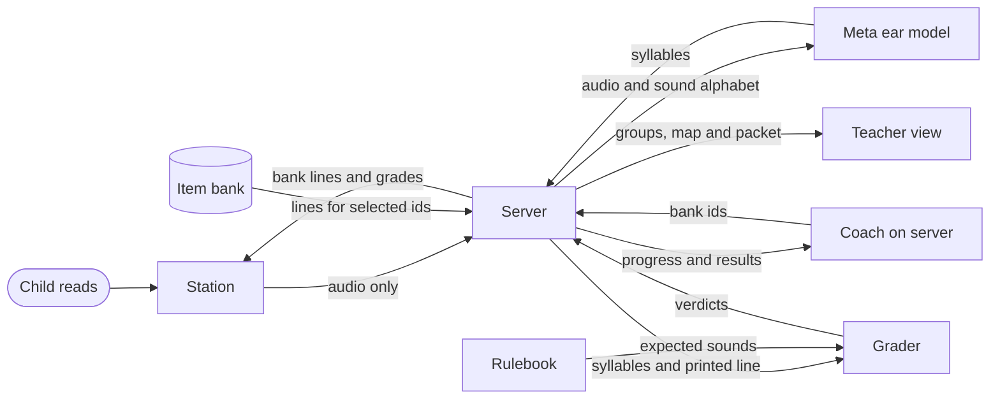

# Kriah Listener

Kriah Listener is a classroom station for reading Hebrew with nekudos. A child taps an animal, reads a line, and sees the previous line marked in green or amber under the letter and vowel they missed. Teachers get practice groups, a letter and vowel map, and printable packets.

Built by Rabbi Dr. Levi Druin for the Meta Global AI Developer Hackathon, October 26 to November 4, 2026, Indie track. Claude Code and Codex were used as coding assistants; every commit in this repo was made during the event.

## How it works



1. **Ear.** The model gets audio and a sound alphabet. It never sees the printed line, so the line cannot steer its answer. It can still mishear. A heuristic rejects responses longer than six whitespace tokens when they contain a listed refusal phrase or at least two distinct listed prose words; the parser replaces syllables outside the sound alphabet with `?`.
2. **Rulebook and grader.** Plain code defines expected sounds in Sephardi, Ashkenazi and Chassidish pronunciation. The grader aligns the heard sounds with the printed line. Flagged readings can accept alternatives.
3. **Coach.** The server runs the coach at each checkpoint. Code checks model picks against bank ids and allowed levels, then the server resolves the ids to bank lines. A rule selects lines when the model is unavailable or its answer fails validation. The rule fallback is what has run so far.

## Meta models

| Job | Model | Host | Status |
| --- | --- | --- | --- |
| Ear, primary | `meta-models/muse-spark-open-1026` | Baseten | Wired; never run |
| Ear, fallback | `muse-wonder-1.0` | Meta Model API | Ran on synthetic clips |
| Coach | `muse-spark-1.3` | Meta Model API | Wired; live run pending |

Only Muse Wonder 1.0 through the Meta Model API has run as the ear. An earlier coach call exhausted its token limit on reasoning and always used the rule fallback. A fix is in progress; no live coach answer has been recorded.

## What the tests show so far

- **Rulebook.** AI reviewers checked every distinct siddur word in all three traditions. A second AI review confirmed each finding. Fixes have regression tests and a before and after comparison of every word. No human kriah teacher has reviewed it yet. [Review](docs/check/rulebook-review.md) and [Shema page for the hand check](docs/check/shema.md).
- **Synthetic ear test.** The script defines 13 clips: 7 contain a planted mistake and 6 are clean controls. Muse Wonder 1.0 wrote the planted mistake on 5 of the 7 plants in each of two recorded runs. The saved notes do not support a complete grader accuracy rate. [Results and limits](docs/ear-test.md).
- **Offline tests.** The root and station test suites pass. These checks use synthetic inputs and model substitutes. They do not establish accuracy on real voices.
- **Real voices.** Neither the adult nor child round has run. The real-voice test is still the go or no-go.

### Before the child round

- Obtain written parent consent.
- Turn Meta Model API free credits off and a paid plan on. Meta's free-credit terms allow content to be used for product improvement.
- Pass the adult round first.

## Data and privacy

The ear never sees the text it grades. No model writes Hebrew a child reads. There is no chat or free-text AI feedback in child, teacher or parent screens. Messages use templates. Model reasons are available only in the PIN-protected developer trace when enabled. Use standard tier only, never contributor mode. Keys stay on the server.

The station and server grade children's audio in memory and drop it. They never write audio to disk or a log. `data/store.json` holds first names, avatars, pronunciation presets, progress profiles, per-letter and vowel read history, stars and turn summaries with coded decisions and template logs. It holds no audio, transcripts or coach reasons. Teachers must enter first names only; the server enforces a single word, not whether it is a first name.

The separate [local clip recorder](tools/clip-recorder/README.md) saves test WAVs in gitignored `recordings/private/`. Child recording requires written parent consent. Its child test runner deletes each clip after printing the result, including failures, unless `--keep` is set. Adult clips remain until manually removed. Closing the recorder does not delete saved clips.

## Run it

Use Node 22.12 or newer. Dependencies are in `station/`.

For a keyless preview, start from the repo root:

```bash
cd station && npm ci && npm run dev
```

Open http://localhost:5173/?mock. Mock mode shows invented children, simulated grades and teacher screens without a microphone, API keys or a backend. Any PIN of 4 to 12 digits opens the mock teacher view. Vite uses its default port because `station/vite.config.js` has no port override.

For the real station, use a fresh terminal at the repo root:

```bash
cp .env.example .env
npm --prefix station ci
npm --prefix station run build -- --configLoader native
```

Set the API key and teacher PIN in `.env`, then run from the repo root:

```bash
node server/index.js
```

Open http://localhost:8787. The first screen is empty until a teacher adds children: tap Teacher, enter the PIN, open Roster, and add a child. Set `TEACHER_PIN` to 4 to 12 digits. The PIN pad accepts digits only and caps input at 12; the live server compares the configured value without enforcing a minimum length.

| Environment variable | Purpose |
| --- | --- |
| `META_API_KEY` | Meta Model API key for the fallback ear and coach. |
| `BASETEN_API_KEY` | Optional Baseten key for the primary ear. |
| `TEACHER_PIN` | Enables teacher routes; use 4 to 12 digits for the station. |
| `TRACE` | Set to `1` to enable the protected developer trace at `#/trace/<turnId>`. |
| `COACH_MODEL` | Set to `off` to use the rule alone; otherwise model calls are enabled. |
| `DATA_DIR` | Store directory; defaults to `./data`. |
| `PORT` | Server port; defaults to `8787`. |
| `EAR_PRIMARY_MODEL` | Baseten model id; defaults to `meta-models/muse-spark-open-1026`. |
| `EAR_FALLBACK_MODEL` | Meta ear model id; defaults to `muse-wonder-1.0`. |
| `EAR_REASONING_EFFORT` | Meta ear reasoning effort; defaults to `minimal`. |

Run the offline checks from the repo root:

```bash
node --test
npm run test:station
```

Other tools, also from the repo root:

- `npm run record` starts the local clip recorder and prints its address.
- `npm run ear-test` compares recorded clips with their scripted sounds. It defaults to the fallback when no Baseten key is set and prints the selected model. `--model primary` or `--model fallback` overrides this choice. This command checks transcription, not grader verdicts.
- `npm run check:page -- shema` rebuilds the page for a kriah teacher to check.
- `npm run grade -- --preset ashkenazi --line "שַׁבָּת" --heard "sha-vos"` grades typed sounds.

## Layout

| Path | Contents |
| --- | --- |
| `rulebook/` | Expected sounds and skill tags. |
| `bank/` | Generated and committed items, source text and blocklist. |
| `ear/` | Audio model calls, sound parser and prompt. |
| `grader/` | Sound alignment and verdicts. |
| `coach/` | Rule selection and validated model picks. |
| `server/` | API, roster, saved progress, groups and packets. Each packet includes a challenge from the bank's 150 challenge items. |
| `station/` | Child and teacher screens. |
| `tools/` | Local test tools, including `tools/clip-recorder/`. |
| `recordings/` | Recording instructions and synthetic clip script. Audio stays out of git. |
| `docs/` | [Documentation index](docs/README.md). |
| `docs/api.md` | Server routes and persistence. |
| `docs/rulebook.md` | Pronunciation rules and outputs. |
| `docs/bank.md` | Item generation and source text. |
| `docs/ear-test.md` | Synthetic results and real-voice protocol. |
| `docs/demo-script.md` | Demo voiceover and shots. |
| `docs/check/` | Automated rulebook review and the Shema hand-check page. |
| `docs/reviews/` | Regression findings and fixes. |
| `docs/build-log.md` | Build history from the git log. |
| `CLAUDE.md` | Author's working brief. |

## Credits

Levels 3, 5 and 6 use Hebrew text from *The Metsudah Siddur (1981)*, via [Sefaria](https://www.sefaria.org/Siddur_Ashkenaz), licensed [CC-BY](https://creativecommons.org/licenses/by/). The text was cut into lines and filtered to exclude unpointed segments. Section references and source links are in `bank/data/siddur.json`.

Frank Ruhl Libre and Montserrat are licensed under the [SIL Open Font License](https://openfontlicense.org/). The station loads them from Google Fonts at runtime. The clip recorder serves bundled copies locally.
