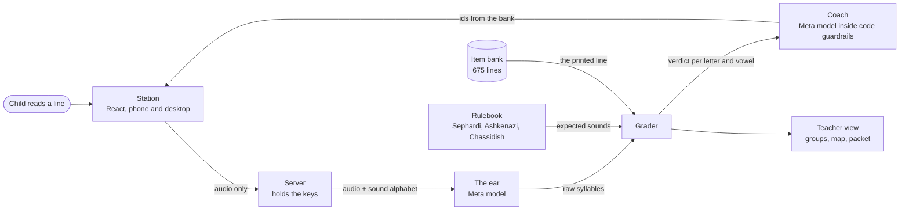

# Kriah Listener

A classroom reading station for Hebrew with nekudos. A child taps their animal, reads one line from the screen, and the line above lights up letter by letter: green where they read it right, a soft amber mark under the exact letter or vowel they missed. The teacher never listens to a recording. They get groups for tomorrow morning, a letter and vowel map for every child, and a practice sheet to print.

Built for the Meta Global AI Developer Hackathon, October 26 to November 4, 2026, Indie track, solo. Every commit in this repo was made during the event. The project rules are in [CLAUDE.md](CLAUDE.md).

## How it works



Three parts, and none of them guesses.

1. **The ear hears without reading.** A Meta model gets the audio and a 26-sound alphabet. It never sees the line, so it cannot hear what it expects. It writes what the child said, `sha-vos`, even when the line says שַׁבָּת.
2. **The rulebook is the judge.** Plain code that knows what every letter and vowel should sound like in three pronunciation traditions, including sheva na and nach, kamatz katan, dagesh, silent letters and the divine names. Cases a kriah teacher would argue about are flagged, and the grader accepts either reading. The ear is never told the child's tradition; the grader applies it.
3. **The coach picks the next set.** After every two or three lines, a Meta model looks at what this child has read and picks the next lines from the bank. Code checks every id it picks against the bank and the allowed levels before anything reaches the screen, and falls back to a plain teacher's rule. The coach never writes Hebrew a child reads and never writes text a child, teacher or parent sees.

## Meta models

| Job | Model | Host | Status |
| --- | --- | --- | --- |
| The ear | `meta-models/muse-spark-open-1026` (open weights) | Baseten | Wired, not yet run: waiting on an API key |
| The ear, fallback | `muse-wonder-1.0` | Meta Model API | Running |
| The coach | `muse-spark-1.3` | Meta Model API | Running |

Standard tier only; nothing runs in contributor mode.

## What the tests show so far

- **Rulebook.** Every one of the 749 distinct words in the siddur text was checked in all three traditions by a panel of AI grammar reviewers, each finding confirmed by a second reviewer. Four classes of error were found and fixed, each with regression tests: [docs/check/rulebook-review.md](docs/check/rulebook-review.md). The Shema page, written out as the rulebook would read it, is at [docs/check/shema.md](docs/check/shema.md) for a kriah teacher to check by hand.
- **The ear, synthetic voices.** Thirteen clips from the macOS Hebrew and English voices with planted mistakes. Muse Wonder 1.0 wrote the planted mistake on 5 of 7 plants in each of two runs and never answered in prose; the other Meta models we tried did worse. Through the real grader, 7 of 10 clips were graded exactly as planted. Full tables: [docs/ear-test.md](docs/ear-test.md).
- **The ear, real voices.** Not run yet. An adult round and a round with children, with written parent consent, are next, using the clip recorder in `tools/clip-recorder/`. This is the go or no-go for the project, and the results will be published here whatever they show.

## Data rules

- Children's audio is graded and dropped. It is never written to disk or logged; only the verdicts are stored.
- Children are stored by first name only, with an animal avatar.
- No chat anywhere. Every sentence a child, teacher or parent reads is a template filled from verdicts. The coach's own reasons appear only in a developer trace, off by default.
- API keys live in `.env` on the server. The browser never talks to Meta or Baseten.

## Run it

Node 22. No dependencies outside `station/`.

```bash
npm test
```

```bash
cd station && npm ci && npm run build
```

```bash
cp .env.example .env
```

Fill in `.env`: `META_API_KEY` for the Meta Model API, `BASETEN_API_KEY` (optional), and `TEACHER_PIN`, any number of four or more digits. Optional: `TRACE=1` turns on the developer trace at `#/trace/<turnId>`, `COACH_MODEL=off` uses the plain rule only, `EAR_PRIMARY_MODEL` and `EAR_FALLBACK_MODEL` override the ear, and `DATA_DIR` moves the saved progress.

```bash
node server/index.js
```

Open http://localhost:8787. To see every screen with no keys and no server, run `cd station && npm run dev` and open the page with `?mock` in the address.

Other tools: `npm run grade -- --preset ashkenazi --line "שַׁבָּת" --heard "sha-vos"` grades typed syllables, `npm run record` opens the clip recorder, `npm run ear-test` sends the recorded clips to the ear, and `node ear/cli.js <folder>` prints what the ear heard for each file.

## Layout

| Folder | What it is |
| --- | --- |
| `rulebook/` | Expected sounds for every word in three traditions. Pure functions, no network. |
| `bank/` | The 675 lines a child can see, levels 1 to 6: letters with vowels, syllables, siddur words, nonsense words (150 of them single-word challenges), phrases and fluency lines. |
| `ear/` | The prompt and the call to the Meta model. Rejects answers in prose. |
| `grader/` | Aligns what was heard with what was printed and gives every letter and vowel a verdict. |
| `coach/` | Picks the next set inside code guardrails, with the plain rule as the fallback. |
| `server/` | Holds the keys, the roster, saved progress, the class view, packets and parent lines. |
| `station/` | The child's station and the teacher's screens, phone and desktop. |
| `tools/clip-recorder/` | A local page for recording test clips, and a runner that grades them. |
| `docs/` | The API, the rulebook, the bank, the ear test and the demo script. |
