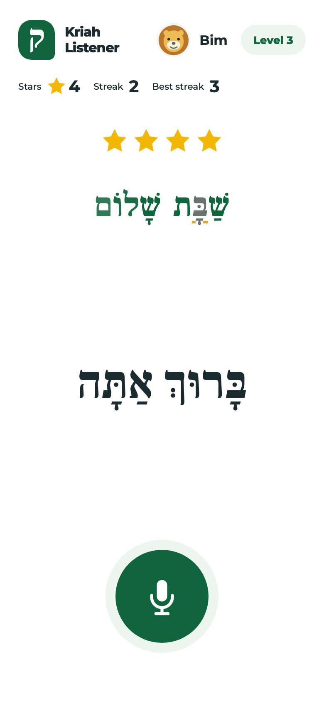
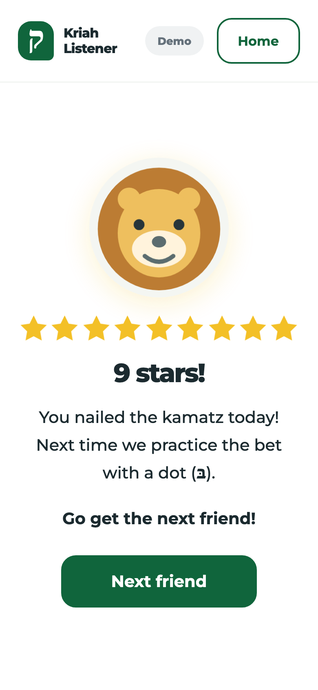
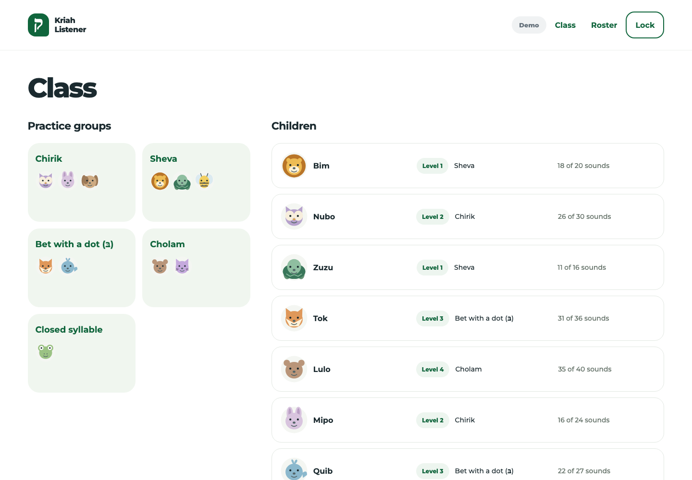
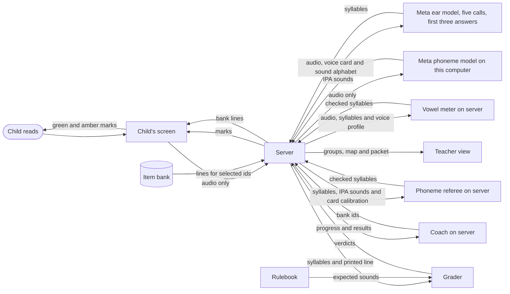

# Kriah Listener

A child reads one line of Hebrew aloud and sees, letter by letter, what they read right. The teacher gets practice groups, a letter and vowel map, and a printable packet without listening to a recording.

<p>
  
  
</p>


Screenshots from mock mode: invented children and simulated grades.

## Why kriah

Kriah is learning to decode Hebrew with its vowel marks, called nekudos. It is taught in the first years of Jewish day school. One teacher cannot listen to every child read every day. The mistakes that matter are small: a missed dagesh, a sheva read wrong, a kamatz katan. Children read aloud in three pronunciation traditions: Sephardi, Ashkenazi and Chassidish. A generic speech tool can mark a correct reading wrong when it expects another tradition.

## How it works



1. **Ear.** A child taps an animal and reads a line. The model gets audio and a sound alphabet. It never sees the printed line, so the line cannot steer its answer. If the child says `sha-vos`, the ear writes `sha-vos`. It can still mishear. At the station the primary ear is asked five times at once, and the server grades as soon as three answers arrive, keeping the most common answer, word by word, with the earliest call breaking a tie. The ear test asks three times and waits for all three. Prose, including short refusals, counts as a failed call; syllables outside the sound alphabet become `?`.
2. **Vowel meter.** Before a child's first line, the station shows a card of the vowels the child has learned: fifteen sounds for a child who knows them all. The server measures how this child says a, o, e and i and keeps those averages. On each graded line it measures every vowel in the audio. Where the ear wrote a, the meter compares that vowel with the child's own a, o and e; where it wrote e, with the child's e and i. If another of the child's vowels fits clearly better, the meter writes that one. This answers the ear's habit of writing Israeli vowels for an Ashkenazi reader. It never adds or removes a syllable, and it leaves the line alone when the sounds it finds do not match the ear's syllable count. The primary ear also hears the child's card recording before each line, so it can compare this child's kamatz and patach in one voice. The card goes only when the child kept each vowel pair apart on it, because a card read wrong teaches the ear wrong.
3. **Phoneme referee.** The ear knows Hebrew words, and for a word it knows it often still writes the Israeli vowel. Meta's open phoneme model, wav2vec2, runs on the same computer as the server. It writes what it hears as IPA phonemes, with no word list or language model behind it. It hears the child's card first, which sets where this child's kamatz and patach fall. On each line the referee checks only the ear's a, o and e: it writes o where the model clearly heard a back vowel, and undoes an o where the model clearly heard a front one. Where the model is known to mishear, before a final l and on a word's last open syllable, the vowel meter decides instead, and a vowel neither can place becomes `?`, which is never marked wrong. An o the model heard as a rounded vowel becomes u, unless the meter measures an a. When the vowel counts differ, the referee lines them up and acts only where every best line-up agrees. It never sees the printed line. The audio for this check never leaves the computer.
4. **Rulebook and grader.** Plain code defines expected sounds in all three traditions. The [grader](grader/README.md) compares `sha-vos` with what שַׁבָּת should sound like in the child's tradition. In Ashkenazi pronunciation the bet should be b, so the amber mark lands under the bet. The previous line shows green and amber marks while the child reads the next line. Flagged cases accept alternative readings.
5. **Coach.** The server runs the [coach](coach/README.md) at each checkpoint to pick the next bank ids. Code checks the ids and allowed levels, then resolves them to bank lines. A rule selects lines when the model is unavailable or its answer fails validation.

## Meta models, and what we learned

The [ear test notes](docs/ear-test.md) record the synthetic trials and the adult round. The [live run](docs/live-run.md) records a full turn through the server.

| Job | Meta model | What happened |
| --- | --- | --- |
| Ear | Muse Spark 1.3 | Corrected children toward real words: it heard `sha-vos` and wrote `sha-bos`. With made-up example sounds in the prompt, it wrote the planted mistake on 1 and then 4 of the 7 plants, and wrote `?` on 7 and then 4 of the 13 clips. |
| Ear | Muse Spark 1.2 | Answered in English prose on about a third of the clips with the first prompt. With made-up example sounds, it wrote 2 of the 7 plants in each run and answered in prose on 3 and then 2 of the 13 clips. Prose counts as a failed call. |
| Ear | Muse Wonder 1.0 (`muse-wonder-1.0`), Meta Model API | Chosen as the primary ear. Wrote the planted mistake on 5 of the 7 plants in each of two runs, with no prose. Minimal reasoning brought it to 2.4 seconds a clip, from about 15. Used as the ear in the full server run. On a real adult voice the grader marked 9 of 10 planted mistakes from its answers, but it wrote Israeli vowels for an Ashkenazi reading, so the adult round did not pass. Hearing the reader's voice card first cut those false marks by about a third, but it then sometimes wrote o for a patach that was said, which hid some planted mistakes. It is now asked three times per reading in the ear test, and five times at the station, which grades from the first three answers; the most common answer is kept. |
| Referee | wav2vec2 Large LV-60 phonemes (`facebook/wav2vec2-lv-60-espeak-cv-ft`), open weights, on this computer | Writes phonemes, with no word list or language model. On Levi's voice it heard kamatz as a back vowel and patach as a front one on all 12 syllables of the card tests and on 52 of 58 syllables in his readings. Run after the meter on the saved Round 1d answers, the clips its rule was designed on, it cut false marks from 72 to 36 and caught 62 of 66 plants against 60. On 12 sealed words over three runs it cut false marks from 10 to 6 and caught as many plants, 10 of 12. With rules added after that, on 460 saved design readings, false marks fell from 99 to 33, and all 220 plants were caught. |
| Vowel probe | The same wav2vec2 model, read at the sixth of its 24 layers | Where its letters are least reliable, before a final l, on a word's last open syllable and in the middle band, the referee compares the vowel with the reader's own card inside the model and takes the nearer of the card's a and o. Replayed over nine saved design sets, 414 readings, it caught every plant, added no false mark, and cut uncertain syllables from 12 to 3. Its setting was chosen on those readings, so they are not a test. Off unless the lab runner is given `--probe`; the station does not use it yet. |
| Follow | The same wav2vec2 model | At the station, the line read so far goes to the phoneme model every 400 milliseconds, audio only. The station counts the vowels it hears and enlarges the printed word being read. It never sees the text and never changes a grade. |
| Ear | Muse Voice Transcribe 1.0, Meta transcription API | Tried and rejected. Fast, but writes words, corrects toward real ones and drops nikud. |
| Ear | Muse Spark Open (`meta-models/muse-spark-open-1026`), Baseten | The fallback ear. Filled in a skipped word from memory. On the Shema line of the adult round it wrote back the word the reader skipped, without seeing the text. The grader marked 6 of 10 planted mistakes from its answers, fewer than Wonder. |
| Coach | Muse Spark 1.3 (`muse-spark-1.3`), Meta Model API | First failed live by spending its whole 2,000 token limit on reasoning. With 16,000 tokens and minimal reasoning, answered 7 of 7 checkpoints in the live run. All picks passed validation. |

Meta may train on content sent in contributor mode, so only standard tier is used. No model id ending in `-contributor` is used: the ear refuses those ids, and the coach uses a fixed standard id.

## What the tests show so far

### Status as of 2026-10-30

- **Rulebook.** AI reviewers checked every distinct siddur word in all three traditions. A second AI review confirmed each finding. Fixes have regression tests and a before and after comparison of every word. No human kriah teacher has reviewed it yet. [Review](docs/check/rulebook-review.md) and [Shema page for the hand check](docs/check/shema.md).
- **Synthetic ear test.** The script defines 13 clips: 7 planted mistakes and 6 clean controls. Wonder reported 5 of the 7 plants in each of two recorded runs. The saved notes do not support a complete grader accuracy rate. [Results and limits](docs/ear-test.md).
- **Live server run.** Synthetic speech completed 25 of 25 lines. The coach answered 7 of 7 checkpoints with valid picks. This checks the full path through the server, not accuracy on real voices. A second run on October 30, through the station Levi's son will use, graded 12 of 12 lines, moved the invented child up a level and saved its stars. [Run record](docs/live-run.md).
- **Offline tests.** 1249 root tests, 203 station tests and 36 phoneme service tests pass. They cover sheva na and nach, kamatz katan, dagesh, silent letters, the divine names, restarts and rereads in the alignment, and all three traditions. They also check server retries, saved progress, packet selection and station screens. Synthetic inputs and model substitutes do not establish accuracy on real voices.
- **Real voices.** The adult round ran on October 27 and did not pass. The grader marked 9 of the 10 planted mistakes, but Muse Wonder 1.0 wrote Israeli vowels for an Ashkenazi reader, so 7 or 8 correct sounds per run were marked wrong. Prompt and reasoning changes did not fix it. Muse Spark Open on Baseten did worse: 6 of 10, and it filled in a skipped word of Shema from memory. [Results](docs/ear-test.md#round-1-results-october-27).
- **Vowel meter.** Built the same morning to answer the Israeli vowels. On Levi's saved answers it marked 10 of 10 plants with 4 false marks on Round 1, against 16 for the ear alone, and 4 of 4 with 3 false marks on 11 new words. Those words helped find the fix. On 11 sealed words it caught all 4 plants but cut false marks only from 17 to 15, because inside words Levi's kamatz measures close to his patach. [Results](docs/ear-test.md#vowel-meter-results-october-27) and [sealed words](docs/ear-test.md#round-1c-results-october-27).
- **Voice card to the ear.** The primary ear now hears the child's voice card before each line, when the card kept each vowel pair apart. On 12 more sealed words, with the meter, it caught 10 of 12 plants against 9 without the card and left 14 false marks against 20 over three runs. In 3 of 36 readings it wrote o for a patach that was said, which once hid a planted mistake: yam came back as yom. [Results](docs/ear-test.md#round-1d-results-october-27).
- **Vote and phoneme referee.** The primary ear is now asked three times per reading, and the most common answer is kept, word by word. Then Meta's open phoneme model, on this computer, checks the a and o in its answer against the child's voice card. On 12 more sealed words over three runs, the ear wrote an Israeli a for a kamatz five times, and the referee fixed each of the four it checked. It caught 10 of 12 plants, as many as without it, and cut false marks from 10 to 6. No run passed: one left no false marks but missed a plant, and one caught every plant with one false mark. Apart from one reading the referee did not get, each error left is the ear writing o where the reader said a. The child round has not run. [Results](docs/ear-test.md#round-1e-results-october-27).
- **Referee rules from the design rounds.** More calls did not help: one, three and five calls per reading left the same false marks, because the ear repeats its mistakes on a recording. More thinking hid more planted mistakes: at medium reasoning the ear wrote the word it recognized and hid 6 of 22, against 2 at minimal, and a reading took 25 seconds instead of 6. So the referee got new rules, designed on the 46 clips of Rounds 1 to 1d: the meter decides before a final l and on a word's last open syllable, an o heard as a rounded vowel becomes u, and a line whose vowel counts differ is lined up. Over 460 saved design readings, false marks fell from 99 to 33, all 220 plants were caught, and 10 syllables became uncertain. These readings shaped the rules, so they are not a test. The replay also found a grader bug, now fixed: when a reader skipped the word between the two divine names of Shema, the marks landed on the wrong words. Fresh design words, Round 1f, and a sealed round, Round 1g, come next. [Results](docs/ear-test.md#referee-rules-from-the-design-rounds-october-27). Round 1g's pass rule was fixed before any of its clips were recorded: [the rule](docs/ear-test.md#round-1g-sealed-test).
- **Vowel probe.** Where the phoneme model's letters are least reliable, the referee now asks the model a second question, read from inside it: is this vowel closer to the reader's own a or o? On nine saved design sets it caught every plant, added no false mark and cut uncertain syllables from 12 to 3, and Round 1d passed end to end with it. Those readings chose its setting, so Round 1f decides, by a rule written before it was recorded, whether the probe joins Round 1g. [Probe](docs/ear-test.md#vowel-probe-october-27).
- **Round 1f and Round 1g.** Levi read a second sitting on October 30. On Round 1f, the design words, the probe caught every plant but twice marked a correct so-ro wrong, where the rules without it left one vowel uncertain, so by the rule written in advance Round 1g ran without it. Round 1g, thirteen sealed words over three runs, caught all 12 planted mistakes with nothing left uncertain, and the meter and referee cut the ear's 23 false marks to 4. It still failed, because its rule allows no false mark: su-ko came back su-ka in every run, and once the grader marked a correct oy-lom wrong because the ear split it into two words. Round 1h, thirteen more sealed words from the same sitting, ran with one change fixed in advance, a grader fix for a word the ear splits in two. Two of its three runs were clean, every plant caught and nothing marked wrong, but in the third all three of the ear's answers heard the i of sim-cho as e, so it fails. [Round 1h](docs/ear-test.md#round-1h-results-october-30). [Round 1f](docs/ear-test.md#round-1f-results-october-30) and [Round 1g](docs/ear-test.md#round-1g-results-october-30).
- **Round 1i: the first sealed round to pass.** Thirteen more sealed words from a third sitting, leaning on chirik and segol, where Round 1h failed. They ran three times on rules fixed in advance, with nothing new: an i and e referee built after Round 1h was tried on the design rounds first, changed 21 correct readings and fixed none, so it stayed off. All three runs pass: every planted mistake caught, no correct reading marked wrong, nothing uncertain. Muse Wonder heard every i and e as said; on its own it left 5 or 6 false marks a run, mostly an a written for an o, and twice heard a planted kof as kaf. The vowel meter and Meta's phoneme model, checking its answer against the reader's own voice card and never the printed text, cut those to 0. [Results](docs/ear-test.md#round-1i-results-october-30).
- **Round 1k: connected prayer lines, a design set.** Ten lines from the station's own bank, read at a normal pace with five planted mistakes. Muse Wonder's a against o confusion grows on connected reading, to 12 to 19 false marks a run. The vowel meter changed nothing on these lines; Meta's phoneme model cut the false marks to 3, 3 and 5 and caught 4 of 5 plants in every run. What remained: kamatz heard as patach, tzere heard without its y, a soft h, and one plant the referee skipped. Two fixes followed, both using Meta's phoneme model: the meter now places vowels by the model's timing on whole lines, and the referee leaves out sound said a second or more after the line. A third keeps the meter to a and o on whole lines. Replayed on the same answers, every plant is caught in every run and 2 false marks remain per run, both on questions of what counts as a mistake: a tzere read e, and a soft h. [Results](docs/ear-test.md#round-1k-results-october-30).
- **The classroom station, live.** On October 30 Levi read prayer lines at the always-on station: one tap keeps the microphone on, each line is graded as he moves on, the syllable the ear heard shows under each mistake, and Meta's phoneme model follows along to enlarge the word being read. Most kamatz first came back as patach. The cause was the browser: with Chrome's noise suppression and echo cancellation on, the phoneme model put Levi's patach at 0.54 on its back-vowel scale, against 0.12 on the test recorder, which turns them off. With them off at the station too, the first line's three false marks were gone. Four syllables in three correctly read words were still marked: a kamatz heard as patach, mostly at the end of a word, and a chirik heard as segol. [Live run](docs/live-run.md#third-live-run-2026-10-30-the-always-on-station).

### Before the child round

- Obtain written parent consent.
- Turn Meta Model API free credits off and a paid plan on. Meta's free-credit terms allow content to be used for product improvement.
- Pass an adult sealed round first. Done: Round 1i, October 30.

## Data and privacy

The ear never sees the text it grades. No model writes Hebrew a child reads. There is no chat or free-text AI feedback anywhere: child screens, teacher screens and the parent line all use templates. Model reasons appear only in the PIN-protected developer trace when enabled. Keys stay on the server.

The station and server grade audio in memory and drop it. They never write audio to disk or a log. When a child's voice card goes to the ear, the server keeps that one recording in memory to play before each line. It is dropped when the voice check is cleared, skipped or made stale, when the child is removed, and when the server stops. For the phoneme referee, the server sends the card and each reading only to the [phoneme service](phonemes/README.md) on the same computer, at `127.0.0.1`. That service holds the audio in memory, writes no files and logs nothing per request. `data/store.json` holds first names, avatars, pronunciation presets, progress profiles, per-letter and vowel read history, stars and turn summaries with coded decisions and template logs. After the voice check it also holds the child's vowel averages, two numbers each for a, o, e and i, and the referee's calibration: how far back the phoneme model heard the card's a and o, and how many of each it heard. Teachers can clear them from the roster, and a preset change clears them. It holds no audio, transcripts or coach reasons. The store keeps the last 60 turns per child; the detail screen shows the last 20. The server computes earned stars from its own grades and caps the browser's requested award. Teachers must enter first names only; the server enforces a single word, not whether it is a first name.

The separate [local clip recorder](tools/clip-recorder/README.md) saves test WAVs in gitignored `recordings/private/`. Child recording requires written parent consent. Its child test runner deletes each clip after printing the result, including failures, unless `--keep` is set. Adult clips remain until manually removed. Closing the recorder does not delete saved clips.

## Run it

Use Node 22.12 or newer. Dependencies are in `station/`.

For a keyless preview, run from the repo root:

```bash
npm --prefix station ci
npm run demo
```

Open http://localhost:5173/?mock. The gray Demo pill labels mock mode. It shows invented children, fixed simulated grades and teacher screens without a microphone, API keys or a backend. About a third of lines have one or two amber marks. Any PIN of 4 to 12 digits opens the mock teacher view. See the [station README](station/README.md) for screen routes.

For the real station, use a fresh terminal at the repo root:

```bash
cp .env.example .env
npm run build
```

`npm run build` installs the station's dependencies and builds it.

Set the API key and `TEACHER_PIN` in `.env`, then run:

```bash
npm start
```

For the phoneme referee, set up the local phoneme service once, then start it in a second terminal before `npm start`. Setup needs Python 3 and a network connection, and downloads the model into `phonemes/.models`, about 1.3 GB. While it runs, the service keeps the model in RAM, about 1.2 GB. Without it the referee is off and the rest works.

```bash
npm run phonemes:setup
npm run phonemes
```

`npm start` runs `node server/index.js`. On the computer running the server, open http://localhost:8787. The server binds to `127.0.0.1` unless `HOST` is set. Browsers allow the microphone only on https or localhost. Localhost works without https. The server uses http when both `TLS_CERT` and `TLS_KEY` are empty. Set both paths to use https. If only one path is set or either file cannot be read, startup stops with one plain line naming the variable.

**Classroom tablet.** Use a self-signed certificate for the server computer's network IP address. Replace `192.168.1.20` below with that address. Run these commands from the repo root. The `certs/` folder is gitignored.

```bash
SERVER_ADDRESS=192.168.1.20
mkdir -p certs
openssl req -x509 -newkey rsa:2048 -sha256 -nodes -days 365 \
  -keyout certs/server-key.pem -out certs/server-cert.pem \
  -subj "/CN=$SERVER_ADDRESS" -addext "subjectAltName=IP:$SERVER_ADDRESS"
HOST=0.0.0.0 TLS_CERT=certs/server-cert.pem TLS_KEY=certs/server-key.pem npm start
```

On the tablet, open `https://<address>:8787` with that same network address and accept the browser warning once. This has not been tested on a real tablet yet.

The first screen is empty until a teacher adds children: tap Teacher, enter the PIN, open Roster, and add a child. `TEACHER_PIN` must contain 4 to 12 digits. Missing or invalid values stop startup before the server listens. The PIN pad accepts digits and caps input at 12. Startup reports when both ear keys or the station build are missing, without printing a key.

| Environment variable | Purpose |
| --- | --- |
| `META_API_KEY` | Meta Model API key for the primary ear and the coach. |
| `BASETEN_API_KEY` | Optional Baseten key for the fallback ear. |
| `TEACHER_PIN` | Required, exactly 4 to 12 digits. Missing or invalid values stop startup. |
| `TRACE` | Set to `1` to enable the protected developer trace at `#/trace/<turnId>`. |
| `COACH_MODEL` | Set to `off` to use the rule alone; otherwise model calls are enabled. |
| `COACH_REASONING_EFFORT` | Coach reasoning effort; defaults to `minimal`. |
| `DATA_DIR` | Store directory; defaults to `./data`. |
| `HOST` | Listen address; defaults to `127.0.0.1`. Use `0.0.0.0` and TLS for network tablets. |
| `PORT` | Server port; defaults to `8787`. |
| `TLS_CERT` | Optional path to a PEM certificate. Set with `TLS_KEY` for https. Leave both empty for http. An unreadable file stops startup. |
| `TLS_KEY` | Optional path to a PEM private key. Required with `TLS_CERT`. An unreadable file stops startup. |
| `EAR_PRIMARY_MODEL` | Meta ear model id; defaults to `muse-wonder-1.0`. |
| `EAR_FALLBACK_MODEL` | Baseten model id; defaults to `meta-models/muse-spark-open-1026`. |
| `EAR_REASONING_EFFORT` | Meta ear reasoning effort; defaults to `minimal`. |
| `EAR_VOTES` | Primary ear calls per reading, 1 to 5; defaults to 3. |
| `PHONEME_URL` | Local phoneme service; defaults to `http://127.0.0.1:8791`. `off` turns the referee off. Only a local http address is accepted. |

Run the offline checks from the repo root:

```bash
node --test
npm run test:station
npm --prefix station run build -- --configLoader native
```

Other tools, also from the repo root:

- `npm run rulebook -- "שַׁבָּת"` prints tab-separated readings: word, Sephardi, Ashkenazi, Chassidish, flags. Arguments are positional Hebrew text, joined with spaces; quote a whole line or supply separate words. It has no preset flag.
- `npm run record` starts the local clip recorder and prints its address.
- `npm run ear-test` compares recorded clips with their scripted sounds. It uses the Meta primary when `META_API_KEY` is set, otherwise the Baseten fallback, and prints the selected model. When a voice check clip is recorded it runs the vowel meter, and it sends the card to the primary ear and runs the phoneme referee when their checks pass; `--no-meter`, `--no-card` and `--no-referee` turn each off, and `--votes` sets the primary ear's calls per reading. `--model primary` or `--model fallback` overrides this choice. Each table uses the voice card read in its sitting; `--round` grades one table and `--card` names one card for all. It checks transcription, not grader verdicts.
- `npm run ear-score -- run.tsv` grades a saved `ear-test` run with the grader, without calling the ear: plants caught, hidden or unsure, false marks and uncertain marks, per round. `--max-uncertain N --runs-needed K` applies the pass rule. [Score a run](tools/clip-recorder/README.md#score-a-run).
- `npm run check:page -- shema` rebuilds the page for a kriah teacher to check.
- `npm run grade -- --preset ashkenazi --line "שַׁבָּת" --heard "sha-vos"` grades typed sounds.

## Layout

| Path | Contents |
| --- | --- |
| `rulebook/` | Expected sounds and skill tags. |
| `bank/` | Generated and committed items, source text and blocklist. |
| `ear/` | Audio model calls, the vote, sound parser, vowel meter, phoneme referee and [the prompt](ear/prompt.md). |
| `phonemes/` | The [local phoneme service](phonemes/README.md), in Python, that runs Meta's wav2vec2 phoneme model for the referee. |
| `grader/` | Sound alignment and verdicts. See [grader/README.md](grader/README.md). |
| `coach/` | Rule selection and validated model picks. See [coach/README.md](coach/README.md). |
| `server/` | API, roster, saved progress, groups and packets. Each packet includes a challenge from the bank's 150 challenge items. |
| `station/` | [Child and teacher screens](station/README.md). |
| `tools/` | Local test tools, including `tools/clip-recorder/`. |
| `recordings/` | Recording instructions and synthetic clip script. Audio stays out of git. |
| `docs/` | [Documentation index](docs/README.md). |
| `docs/api.md` | Server routes and persistence. |
| `docs/rulebook.md` | Pronunciation rules and outputs. |
| `docs/bank.md` | Item generation and source text. |
| `docs/ear-test.md` | Synthetic results and real-voice protocol. |
| `docs/demo-script.md` | Demo voiceover and shots. |
| `docs/check/` | Automated rulebook review and the Shema hand-check page. |
| `docs/reviews/` | Regression findings, including the [server fix round](docs/reviews/2026-10-26-server-fix-round.md). |
| `docs/build-log.md` | Build history from the git log. |
| `CLAUDE.md` | Author's working brief. |

## Credits

Rabbi Dr. Levi Druin, a Jewish day school principal, designed Kriah Listener and directed its build for the Meta Global AI Developer Hackathon, October 26 to November 4, 2026, Indie track. Every commit in this repo was made during the event.

- **Design.** His plan and project brief, [CLAUDE.md](CLAUDE.md), set the design before the first commit: an ear that never sees the page, a rulebook that serves as the answer key, traditions as sets of accepted sounds, a grader that marks each letter and vowel, a coach that picks from the bank and never writes Hebrew, and no leaderboard.
- **Direction.** His question about Muse Voice Transcribe 1.0 started the trial that ruled it out as the ear. The same test found that minimal reasoning brought Muse Wonder 1.0 from about 15 seconds a clip to 2.4.
- **Real voices.** He reads the adult round. The child round runs only with written parent consent.
- **Code.** Claude Code and Codex wrote the code and tests to the brief. The review rounds are in [docs/reviews](docs/reviews).

Levels 3, 5 and 6 use Hebrew text from *The Metsudah Siddur (1981)*, via [Sefaria](https://www.sefaria.org/Siddur_Ashkenaz), licensed [CC-BY](https://creativecommons.org/licenses/by/). The text was cut into lines and filtered to exclude unpointed segments. Section references and source links are in `bank/data/siddur.json`.

Frank Ruhl Libre and Montserrat are licensed under the [SIL Open Font License](https://openfontlicense.org/). The station loads them from Google Fonts at runtime. The clip recorder serves bundled copies locally.
