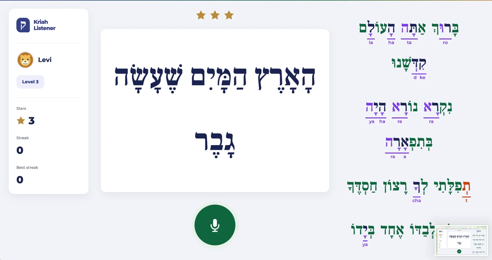
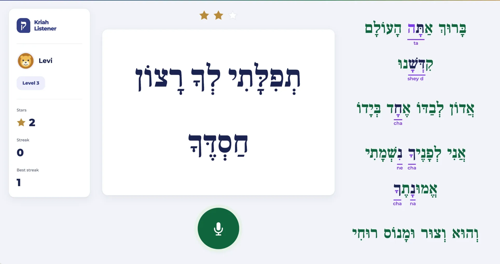

# Live run through the server, 2026-10-26

One full turn through the real server with the coach model on, run at 22:50 Eastern on commit `ea99a36`.

## Setup

- The server ran locally with `COACH_MODEL` on, `TRACE=1` and a fresh data folder.
- A script created one invented child (Sephardi, level 1), started a turn, and read every line the server sent.
- Each line was spoken by the macOS Hebrew voice Carmit, saved as a 16 kHz WAV, and posted to `/api/grade`. No person was recorded.
- The ear was Muse Wonder 1.0 through the Meta Model API, with minimal reasoning. The coach was Muse Spark 1.3 through the Meta Model API.

## What happened

| Check | Result |
| --- | --- |
| Lines graded | 25 of 25, none failed |
| Time per line, speech file plus ear plus grader | 3.8 seconds on average, 2.0 to 9.0 |
| Coach checkpoints answered by the model | 7 of 7 between the start and the stop rule |
| Coach picks that failed validation | 0 |
| Turn length | 8 checkpoints, then the stop rule ended it |
| Coach reasons outside the developer trace | none |
| Files in the data folder afterwards | `store.json` only, no audio |

The model's reasons named the child's actual confusions. For example: "Misses cluster on chirik and chirik-male across varied letters so these lines rebuild that vowel-pattern skill at level 1." Reasons appear only in the protected trace. The ordinary teacher turn log uses the templated line, here "Held level 1 and gave the pattern chirik with a mater yud another try."

## What it does not show

- The score, 64 of 130 sounds, says nothing about the ear's accuracy. A synthetic voice reading isolated level 1 syllables is a poor stand-in for a child, and the run had no planted mistakes to check against.
- This run used synthetic speech. The adult round ran separately on October 27 and did not pass ([results](ear-test.md#round-1-results-october-27)). The child round has not run.

## Second live run, 2026-10-30

One turn through the station Levi's son will use, on the code at `309f79e`: the new station look, the three-vote ear, the vowel meter and the phoneme referee.

- A script added one invented child (Ashkenazi, level 1) through the teacher's roster, sent its voice card, read 12 lines, finished the turn and deleted the child.
- Each line was spoken by the macOS Hebrew voice Carmit, saved as a 16 kHz WAV and posted to `/api/grade`. No person was recorded.

| Check | Result |
| --- | --- |
| Voice check | accepted on the first try |
| Lines graded | 12 of 12, none failed |
| Checkpoints | 4 of 4 answered; the second moved the child up to level 2 |
| Stars saved at the finish | 5 |
| After the deletion | the roster was empty |

The first try spoke each line with no pause between syllables, five syllables in about 1.1 seconds. The ear heard one or two of them, and the rest were marked skipped. With a pause between words, as a child sounds them out, the first three lines scored 5, 4 and 4 of 5.

In the lines after that, most marks fell on a tzere without a yud or a sav without a dagesh. There the Mac's Israeli voice says e and t, where an Ashkenazi reader says ey and s, so the marks are what the Ashkenazi preset is for. A synthetic voice is still a poor stand-in for a child: this checks the path, not the ear's accuracy on a child's voice.

## Third live run, 2026-10-30: the always-on station

Levi read prayer lines at level 3 on the classroom station at his iMac, with the microphone always on: one tap, then line after line, each graded in the background while Meta's phoneme model followed his place. The station keeps no audio, so the marks below are as the screen showed them.

**Before the microphone fix** (`60bfedf`).

Most kamatz syllables came back as patach, such as the la of הָעוֹלָם and the ta of אַתָּה, on lines Levi says he read with kamatz. The clip recorder, used for every design and sealed round, turns Chrome's noise suppression, echo cancellation and automatic gain off; the station left all three on. Its saved voice card showed the difference: Meta's phoneme model scored Levi's patach at 0.54 on its back-vowel scale, where 0 is a and 1 is o, against 0.12 on the clip recorder's Voice check 4. On the station his a and o sat much closer together than on the recordings the rules were built on.

**After the microphone fix** (`cbd9f95`: noise suppression and echo cancellation off, then a new voice check).

Levi read some words wrong on purpose. The marks in אַתָּה, קִדְּשָׁנוּ and אֶחָד are on words he read wrong on purpose. He read לְפָנֶיךָ, נִשְׁמָתִי and אֱמוּנָתֶךָ correctly, and the station still marked four syllables in them: the נִ of נִשְׁמָתִי heard as ne, the final ךָ of לְפָנֶיךָ heard as cha, and the נָ and final ךָ of אֱמוּנָתֶךָ heard as na and cha. Those are the two confusions the sealed rounds found: a kamatz heard as patach, here most often at the end of a word, and a chirik heard as segol. The first line, which had three false marks before the fix, had none.

In Levi's words the station was "much slower" after the change, "but it was more accurate". The likely cause, not yet measured: with noise suppression off, automatic gain lifts the room's hum between words, and a line ends only after 1.2 seconds below a fixed loudness, so lines end late.
